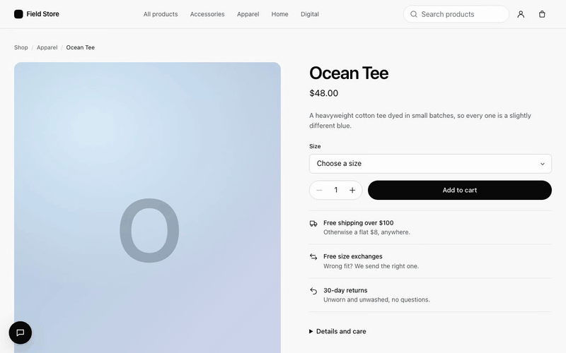

# webmcp-agents

Helpers for [WebMCP](https://developer.chrome.com/docs/ai/webmcp) pages: make every agent action
visible to the person using the page (a ghost cursor, field replay, a parked "waiting for your
confirmation" state) without the tools knowing it exists, plus the tooling around it. A tool is its `execute`
function (and a schema): the cursor finds the control it belongs to by role and name, so nothing is added to your
markup.

```
pnpm install
pnpm dev         # every app: playground :5173, ecommerce :5174, flights :5175. Open the devtools (bottom right, Alt+Shift+A) and run a tool
pnpm check       # biome ci + typecheck + tests + build, everything CI runs
pnpm e2e         # Playwright end-to-end tests of the example apps (desktop + mobile)
# chat: put a provider key in apps/<app>/.env.local (see .env.example; Claude by default, or WEB_AGENTS_MODEL=openai/gpt-5.5 …), then open the Assistant bottom-left
```

Works in any browser: where there is no native WebMCP, the provider loads a polyfill of `document.modelContext` by
itself (its own chunk, never downloaded by a browser that has WebMCP). In a Chrome build with native WebMCP nothing is
loaded and the same code runs against the real API.

## Packages

Docs (introduction, installation per framework, the Build path, concepts, examples and the API reference): [docs/](docs/README.md). The website
is one app, [`apps/docs`](apps/docs/README.md) (`pnpm --filter @webmcp-agents/docs dev`, http://localhost:4321): the
landing page at `/`, whose own actions are WebMCP tools you can try from the page, recorded demos of the examples at
`/demos`, and the searchable docs under `/docs`.

| Package | |
|---|---|
| [`@webmcp-agents/core`](packages/core) | The visual layer (ghost cursor, spotlight, typing into fields, confirmation parking, yield-to-user, `onAgentEvent`), `defineWebTool` (`target`, `fields`, `fill`, `match`, flags, `invoke`), `locate`, `createWebAgents` (the framework-free entry that follows the URL itself) and the tool registry; the `document.modelContext` polyfill it loads where the browser has none (`@webmcp-agents/core/polyfill`). |
| [`@webmcp-agents/react`](packages/react) | `<WebAgentsProvider tools availableTools>` (the same line in every framework; it loads the polyfill where needed and the devtools in development), `useWebTool({ … })` returning `invoke`, `usePathname`, `useEnableTools`; `useToolAnswer` and JSX types for declarative forms. |
| [`@webmcp-agents/tools`](packages/tools) | Common tools, ready-made: `getTime`, `getLocation`, `getPage`, `goTo`, `goBack`, `scrollTo`, `setTheme`. |
| [`@webmcp-agents/polyfill`](packages/polyfill) | Deprecated: re-exports `@webmcp-agents/core/polyfill`, which the provider now loads itself. |
| [`@webmcp-agents/chat`](packages/chat) | `<AgentChat agent>`: a chat widget whose agent (any frontier model on your server through the AI SDK, or a custom `AgentAdapter`) works the live page through its WebMCP tools; `defineWebAgent` for instructions, tool subsets and sub-agents, with `agent.invoke(…)` and `useWebAgent` to run one without a chat; `/api/chat` handler and a Vite dev plugin. |
| [`@webmcp-agents/local-agent`](packages/local-agent) | An on-device `AgentAdapter`: Chrome's built-in model, or a small Qwen3 model in a Web Worker (transformers.js, WebGPU/WASM). Opt-in download; nothing leaves the browser. |
| [`@webmcp-agents/devtools`](packages/devtools) | Devtools panel: the page's tools with a generated form per schema, a timeline of every call (yours or an agent's), cursor settings. Each tool shows the control it finds, the fields it types into, its `match` and its flags. Installed by the provider in development; or by hand: `installWebAgentsDevtools()`, `<WebAgentsDevtools />` or a TanStack Devtools tab. `window.agent.invoke` (`run` is an alias). |

| App | |
|---|---|
| [`examples/playground`](examples/playground) | A storefront where every action is a WebMCP tool: forms as `useWebTool` + React Hook Form, an app-wide catalog with `match`, confirm-gated place-order and clear-cart, and one declarative form as the alternative. |

## Examples

Two realistic sites on mock data, with React Router 7. Each shows
app-wide tools (a catalog, some with `match`), component tools (`useWebTool`) and forms as tools on React Hook Form (Skyline's
traveler details on TanStack Form), and a confirm gate on the consequential step. Each app's README has its tool table.

| App | Port | |
|---|---|---|
| [`examples/ecommerce`](examples/ecommerce) | 5174 | **Field Store**: catalogue, product pages, a cart drawer whose tools exist only while it's open, checkout. |
| [`examples/flights`](examples/flights) | 5175 | **Skyline**: flight search, results with filters and sort, traveler details, booking and look-up. |
| [`examples/nextjs`](examples/nextjs) | 5176 | **Field Store on Next.js**: App Router + shadcn/ui; the chat is a shadcn block from the `@webmcp-agents` registry (`registry/`), `defineWebAgent` shared between the route handler and the client, the key tainted server-side; the same `<WebAgentsProvider tools={tools}>` line as the Vite apps. |
| [`apps/docs`](apps/docs) | 4321 | **The website**: the landing page, the Demos page (agent-browser clips of Skyline and Field Store) and the docs in one site. The site is an example too: its demos, docs links, FAQ, copy buttons, theme switch and search are WebMCP tools (`defineWebTool`), run from the hero's chips ("Try it as an agent would") or by any agent. |

`pnpm --filter @webmcp-agents/example-ecommerce dev` (or `…-flights`) runs one app on its own.



Roadmap and per-phase implementation plans live in [`.agents/plans/`](.agents/plans/00-web-agents-roadmap.md).

## How a tool looks

A tool is one action with two callers. `useWebTool` registers it for agents; the button is what a person clicks.
Nothing is added to the JSX for the cursor: it finds the control by role and accessible name (the tool's `title`), so a
tool needs no `toolname`, ref or id. This is a confirm-gated tool: the cursor parks on "Clear cart" and `clear` runs
only after the person's own click.

```tsx
export function ClearCart() {
  const cart = useCart();

  const clear = () => cart.clear();

  // An agent calls this.
  useWebTool({
    id: "clear_cart",
    title: "Clear cart",
    description: "Empty the cart. The user confirms on the page.",
    destructive: true,
    requireConfirmation: true,
    execute: clear,
  });

  // A person clicks this.
  return (
    <Button variant="destructive" onClick={clear}>
      Clear cart
    </Button>
  );
}
```

A form is the same hook plus an `inputSchema`: the cursor types each value into the field with that name or label (React
Hook Form and TanStack Form inputs hear it like any typing), presses the button, and `execute` runs at the press. For a
widget it cannot type into (a `Select`), `fill: (values) => form.reset(values)` puts the values on screen first.

```tsx
const schema = z.object({
  quantity: z.number().int().min(1),
});

type AddToCartInput = z.infer<typeof schema>;

export function AddToCart({ product }: { product: Product }) {
  const cart = useCart();

  const form = useForm<AddToCartInput>({
    resolver: zodResolver(schema),
    defaultValues: { quantity: 1 },
  });

  const add = ({ quantity }: AddToCartInput) => {
    cart.add(product.id, quantity);
    return `Added ${quantity} × ${product.name}.`;
  };

  // An agent calls this.
  useWebTool({
    id: "add_to_cart",
    title: "Add to cart",
    description:
      "Add this product to the cart. Use after open_product. " +
      "Next: open_cart or checkout.",
    inputSchema: schema,
    execute: add,
  });

  // A person submits this.
  return (
    <Form {...form}>
      <form onSubmit={form.handleSubmit(add)} className="flex items-end gap-2">
        <FormField
          control={form.control}
          name="quantity"
          render={({ field }) => (
            <FormItem>
              <FormLabel>Quantity</FormLabel>
              <FormControl>
                <Input
                  type="number"
                  min={1}
                  {...field}
                  onChange={(e) => field.onChange(e.target.valueAsNumber)}
                />
              </FormControl>
              <FormMessage />
            </FormItem>
          )}
        />

        <Button type="submit">Add to cart</Button>
      </form>
    </Form>
  );
}
```

App-wide tools go in one object, beside the common ones, and the provider is the same line in Vite, TanStack Start,
Next.js and Astro (the library follows the browser's URL itself, so nothing is wired to a router). A tool's `match`
says where it is on (`"/orders"`, `["/cart", "/checkout"]`, a RegExp); `availableTools` narrows what an agent may use
right now.

```tsx
export const tools = {
  getTime: getTime(),
  getPage: getPage(),
  goTo: goTo({ pages: { home: "/", cart: "/cart", orders: "/orders" } }),
  getCart,
  listOrders, // defineWebTool({ id: "list_orders", match: "/orders", … })
};

<WebAgentsProvider tools={tools}>
  <App />
</WebAgentsProvider>
```

`await tools.getCart.invoke()` calls a tool the way an agent would (the cursor moves, confirmation applies);
`await shopper.invoke("Reorder my last purchase.")` runs an agent with no chat on the page. Without React,
`createWebAgents({ tools })` from `@webmcp-agents/core` is the same provider.

```
examples/playground/src/
  webmcp-agents/      ← PURE. No cursor code anywhere.
    tools/               defineWebTool: get_cart (everywhere), list_orders (match "/orders"); index.ts is the catalog
    hooks/
      use-add-to-cart.ts       useWebTool + React Hook Form: add_to_cart_<sku>
      use-clear-cart.ts        useWebTool clear_cart (destructive, requireConfirmation)
      use-place-order.ts       useWebTool place_order (requireConfirmation)
      use-remove-promo.ts      useWebTool remove_promo
      use-apply-promo.ts       answers the one declarative <form toolname="apply_promo"> (the alternative)
  components/         ← UI only: props + hooks (add-to-cart-form.tsx, apply-promo-form.tsx, cart-panel.tsx, …)
  hooks/              ← app hooks: use-cart.ts (the store in React), use-orders.ts, use-page.ts, use-nav-link.ts
  app.tsx             ← <WebAgentsProvider tools={tools}> (installs the cursor, and the devtools in dev)
  store/cart.ts       ← the cart: a module store
  main.tsx            ← render (the provider loads the polyfill where it is needed)
  devtools.tsx        ← dev only, lazy, with ?tanstack: the devtools as a TanStack tab (devtools={false} on the provider)
packages/core         ← OUR LOGIC. Event-driven, installed once, never imports a tool. Holds the polyfill (src/polyfill/).
packages/react        ← provider + hooks: which tools are on, registered without churn; loads the devtools in dev
packages/polyfill     ← deprecated: re-exports core's polyfill (document.modelContext + declarative forms + events)
packages/devtools     ← dev only: the panel that plays the agent and records every call (react depends on it, not back)
```

Declarative `<form toolname>` tools and `toolname` markers still work (the playground keeps one declarative form);
they are covered in the docs' [Declarative forms](docs/more/declarative-forms.mdx) guide. Tools registered by other
libraries (e.g. `use-webmcp-tool`) still animate: the visual layer wraps `registerTool` whoever calls it. See
[packages/react/README.md](packages/react/README.md).

How the visual layer works, its options, yield-to-user and the WebMCP quirks it handles:
[packages/core/README.md](packages/core/README.md).

## Deploy your own

Each example app deploys as its own Vercel project with a guarded `/api/chat` (origin allow-list, per-IP rate limits,
a daily budget). Steps and the env var table: [docs/more/deploy.md](docs/more/deploy.md). Live demos: _coming with the first
deploy_.

## Repository

- pnpm workspaces + Turborepo (`turbo run build|typecheck|test|dev`), Biome for lint and format.
- CI (`.github/workflows/ci.yml`): Biome, typecheck, unit + browser tests, build, size budgets, publint +
  are-the-types-wrong (`check-exports`), then Playwright e2e. Releases: Changesets (`pnpm changeset`), published from
  a maintainer's machine by `pnpm release` (`scripts/release.mjs`); no CI job publishes.
- Packages build with tsdown. In this repo, apps and type-checking resolve packages to their
  TypeScript source through the `"@webmcp-agents/source"` export condition, so edits hot-reload
  without a build; published packages use `dist/`.
- Tests: Vitest. `*.test.ts` run in Node; `*.browser.test.ts` run in real Chromium (Vitest
  browser mode + Playwright). First run: `pnpm exec playwright install chromium`. The example apps
  add Playwright e2e tests in `examples/*/e2e` (`pnpm e2e`), which drive tools through `window.agent`.
