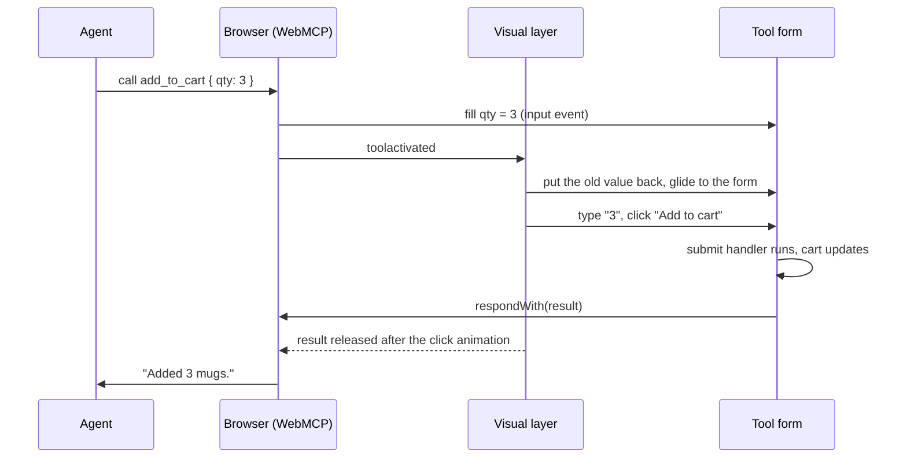

An agent-ready page has three layers, and each one knows as little as possible about the others.

| Layer | What it is | Knows about |
|---|---|---|
| **Tools** | Forms with `toolname`, and `WebTool`s registered through the provider or a registry | the page's own state, nothing else |
| **WebMCP** | `document.modelContext`: native in Chrome, or the [polyfill](/guides/polyfill) | the registered tools; dispatches lifecycle events |
| **The visual layer** | `installAgentVisuals()`: the cursor, the spotlight, yielding | WebMCP events and the DOM, never a tool |

## Tools never know the cursor exists

A tool doesn't call the cursor, import it, or report to it. The **only** contract is an attribute: the element a tool
acts on carries `toolname="<tool name>"`. Declarative forms have it by definition; a `WebTool` puts it on its button,
or points at an element with its `target` selector.

That keeps tools plain and testable, lets you add or remove the cursor without touching them, and means tools from
other libraries (anything that calls `registerTool`) animate too.

## Driven by events

`installAgentVisuals()` subscribes to the WebMCP lifecycle and works everything else out from the DOM at that moment:

| Signal | What the layer does |
|---|---|
| `toolactivated` | finds `[toolname="<name>"]` and glides the cursor there |
| `input` (capture phase) | timestamps each tool-form field as it changes: the fields that change as a run starts are the agent's |
| `submit` with `event.agentInvoked` | replays the agent's values, moves to the submit button, clicks; delays `respondWith` until the animation ends |
| `:tool-submit-active` | parks the cursor on the submit button: "Click Place order to confirm" |
| `toolcancel` | clears highlights and hides the cursor |
| the person's own mouse moves, clicks, scrolls, touches and keys | they took over: [yield](/concepts/agent-cursor#yielding-to-the-person) |



Native Chrome and the polyfill fire these in different orders (Chrome fills, submits, then activates; the polyfill
activates first), so a run starts on whichever signal arrives first.

## In step with the page

<video autoPlay loop muted playsInline data-no-zoom width="960">
  <source src="../media/cursor/typing.webm" type="video/webm" />
  <source src="../media/cursor/typing.mp4" type="video/mp4" />
</video>

*The page reacts at the cursor's click, not before: the add happens when it looks like it should.*

The browser runs an agent's action the instant it's called. A cursor that animated afterwards would always look
late: the cart would update, and only then would the cursor drift over to "Add to cart".

So by default (`sync: true`) the layer makes the page wait for the cursor instead:

| Tool kind | Without the layer | With it |
|---|---|---|
| Declarative form | fields fill and `submit` fires at once | old values go back; the cursor types the agent's values when it arrives; `submit` is held and re-dispatched at the click |
| `WebTool` with a `toolname` element | `execute()` runs at once | `execute()` runs when the cursor presses the element |
| Tool with nothing on screen | `execute()` runs | still runs at once: there's nothing to show |

Your tool code doesn't change; it just runs at the click, so the page reacts in the same frame as the ripple. The
agent gets its answer roughly half a second to a second later than it would without the cursor. A held `execute` is
never held for more than 2.5 s, and cancelling releases it. `sync: false` runs everything at once and animates after
the fact.

:::tip[For every tool to be in sync]
Install the visual layer before any tool registers (`<WebAgentsProvider>` does), and give each tool's control
`toolname="<tool name>"`.
:::

## What the browser does for you

WebMCP's declarative side gives you a lot for free:

- **The schema.** It comes from the form's controls; `toolparamdescription`, or the `<label>`, describes each one.
- **The confirm gate.** Leave out `toolautosubmit` and the browser fills the form, then pauses on the submit button
  until the person clicks. Use it for orders, payments and deletions.
- **Styling hooks.** `form:tool-form-active` and `button:tool-submit-active` are native pseudo-classes, so CSS alone
  can show that an agent is working. The polyfill mirrors them as `[data-tool-form-active]` and
  `[data-tool-submit-active]`; `@webmcp-agents/core/cursor.css` styles both.

## Limits

- `toolactivated` carries only the tool's name, not its arguments, and for declarative forms the browser fills the
  fields itself. So the layer watches `input` events: the fields that change as a run starts are the agent's. Their
  previous values come from a snapshot it refreshes every 400 ms while nothing is running.
- Keystroke-by-keystroke typing of the arguments is only possible for `WebTool`s, whose `execute` receives them.
- If Chrome rejects a fill (a `qty` above the field's `max`, say), it never submits. The layer closes that run after
  `linger`, so the next call starts fresh.
- Wrapping `registerTool` (in sync mode) is the one place the layer patches anything.

## Events for everything else

Every run emits events you can subscribe to, with no access to internals:

```ts
import { onAgentEvent } from "@webmcp-agents/core";

onAgentEvent((e) => {
  // start | fill | park | result | error | cancel | yield | resume
});
```

The devtools timeline and the chat widget are built on exactly these events. In React, use
[`useAgentEvents`](/reference/react/use-agent-events).
