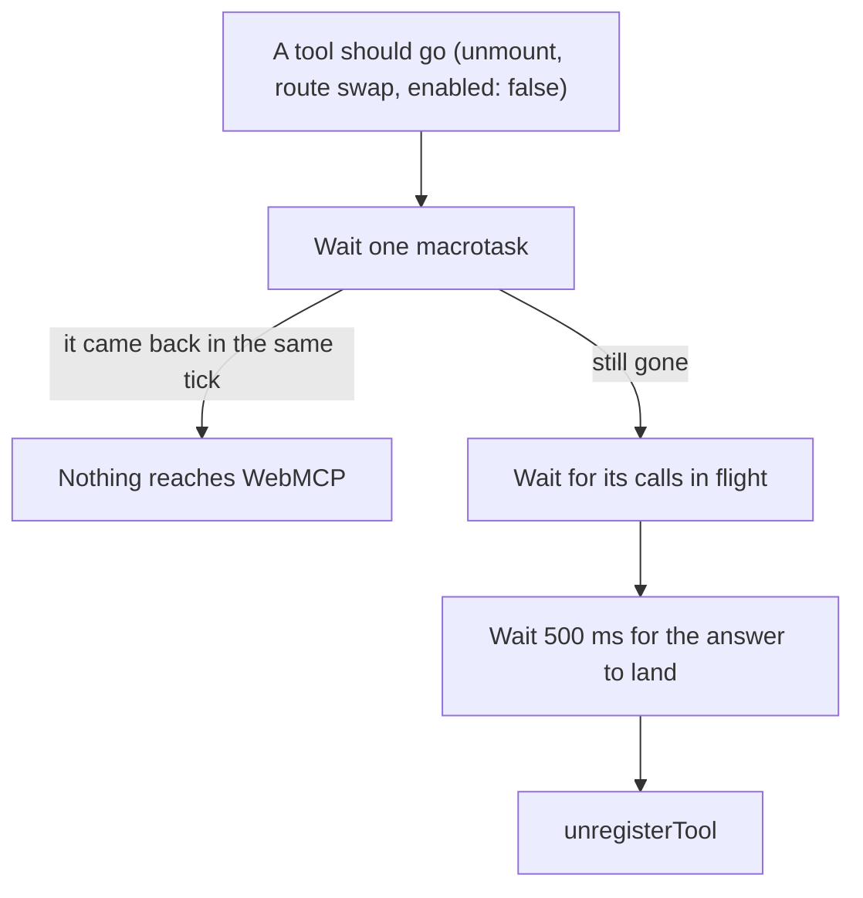
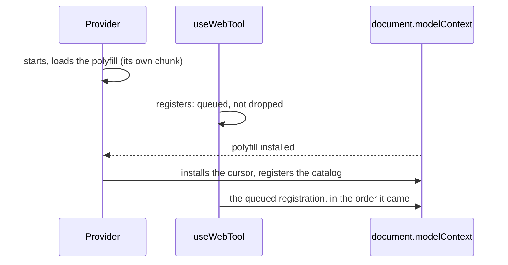

WebMCP has one rule that shapes everything here: **Chrome cancels a call whose tool changes or disappears while it is
running.** Unregister a tool, or register it again with a different definition, and the agent's call in progress fails.

UI code changes tools all the time. React's StrictMode mounts, unmounts and mounts again. A route change unmounts one
page and mounts the next. A cart drawer closes. Done naively, each of those would churn `registerTool` and
`unregisterTool` and cancel calls the agent is waiting on.

## Nothing is released at once

The provider, `createWebAgents`, `useWebTool` and the [registry](/reference/core/create-tool-registry) all release a tool
the same way.

1. **A macrotask.** A release followed by a re-enable in the same tick (StrictMode's remount, or a route swap that keeps
   the tool) never reaches WebMCP at all.
2. **Calls in flight.** Each tool's calls are counted ([`createCallTracker`](/reference/core/create-call-tracker)), and a
   release waits until they have settled.
3. **The answer.** Then another 500 ms (`RESPONSE_GRACE_MS`) so the result reaches the agent before the tool goes.

What that buys you:

- A tool that turns itself off (`clear_cart` emptying the cart, which disables `clear_cart`) still answers.
- A tool whose action navigates away from the page that holds it (checkout leading to a confirmation page) answers
  first: its `execute` returns, and the tool stays registered until the agent has the answer.
- Replacing the whole catalog re-registers only the tools whose definition actually changed.

:::warning[Never unregister from UI code directly]
If you build your own integration, release through [`deferRelease`](/reference/core/defer-release) and a call tracker, or
through the registry. Calling `unregisterTool` from an effect cleanup cancels calls.
:::

## Registrations wait for `document.modelContext`

In a browser without WebMCP there is no `document.modelContext` until the polyfill arrives, and the provider (or
`createWebAgents`) loads it when it starts. The page does not wait for it; the tools do:

- **Nothing renders differently.** The page, the provider's children and every component render on the first paint, on
  the server too; only the registrations come a few milliseconds later.
- **The cursor comes first.** It binds to `document.modelContext` when it installs, so it installs before any waiting
  tool registers, and every tool is animated.
- **Releases keep their rules.** A tool unmounted before the polyfill arrived never registers; one released later is
  released the deferred way above.
- **With native WebMCP nothing waits**, and with `polyfill={false}` nothing loads: a tool registered then is not
  registered, with a warning ([Browsers without WebMCP](/more/polyfill)).

## Keep definitions stable

The provider compares definitions, so a new catalog object with the same tools is cheap. A tool whose description is
rebuilt on every render registers again every render, so define catalog tools at module level.

`useWebTool` already registers again only when what the agent sees changes: the id, title, description, schema, flags,
`requireConfirmation` and a non-function `target`. It always calls the latest render's `execute`, `target`, `fields` and
`fill`, so a definition that closes over state needs no `useMemo`.

## Tools that come and go with the URL

A tool with a [`match`](/build/where-a-tool-is-on) is registered while the path fits and released, the same deferred way,
when it stops fitting. Two facts follow from how the URL is followed:

- **The tool turns on as soon as the URL changes**, which can be before the new route has rendered. A `match` tool must
  not assume state that the page sets when it mounts. Skyline's results tools read the search, so `search_flights` stores
  it before it navigates.
- **The notice arrives just after the navigation call returns.** Next.js changes the URL inside a React insertion effect,
  where telling React about it is an error, so the library waits a microtask. The tool is there a moment after
  `router.push` returns.

## The next step after a navigation

When a tool navigates, the new page's tools register a moment later. An agent that asks for the tool list too early sees
the old page. The chat handles this by waiting until `toolchange` has been quiet for about 150 ms after each tool call,
before its next model request. If you write your own [agent adapter](/reference/chat/adapter-types), do the same.

## Forms that hide or navigate

For a tool you write with `useWebTool`, none of this takes any code: `execute` returns the answer, and the registration
outlives it. A **form that navigates away** answers first, because the return value is the answer.

A [declarative form](/more/declarative-forms) is the exception: the form _is_ the tool, and it must answer synchronously
in its submit handler, so a form that hides itself after its own action has to stay rendered until the agent has its
answer. That page covers [`useToolAnswer`](/more/declarative-forms#a-form-that-hides-itself-usetoolanswer), which does it.
