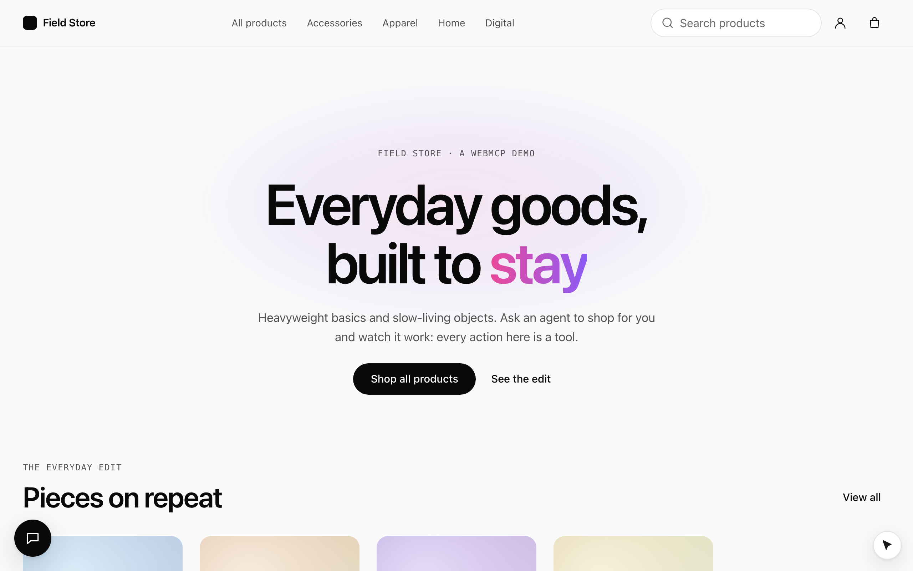
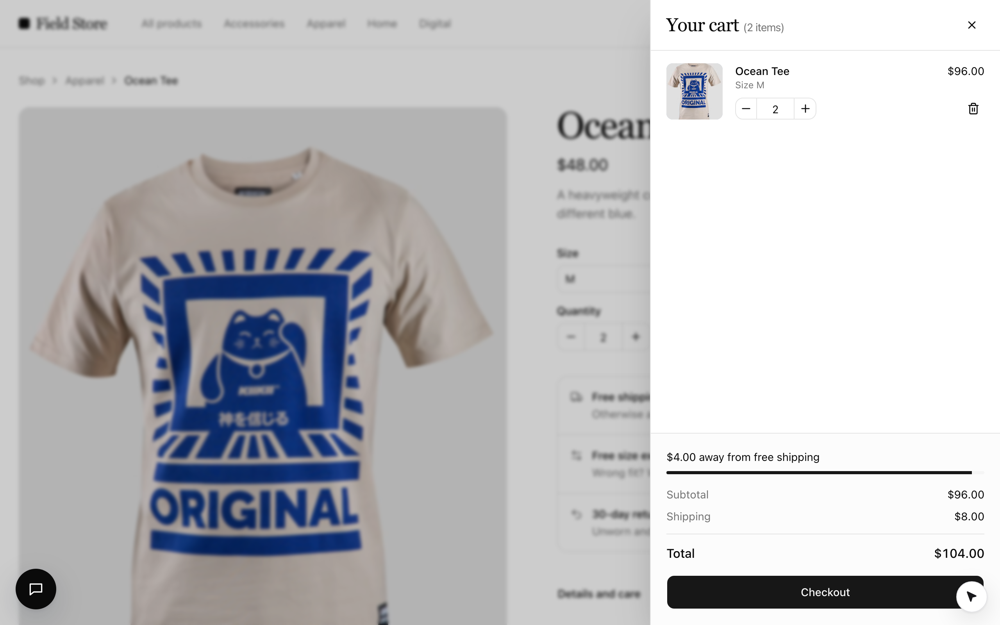

`apps/ecommerce` (**Field Store**) is a minimal, editorial storefront on mock data where every meaningful action is a
tool. It shows the three ways a tool can be on: always, while a route is shown, and while a component is open.





```bash
pnpm --filter @webmcp-agents/example-ecommerce dev    # http://localhost:5174
pnpm --filter @webmcp-agents/example-ecommerce e2e    # Playwright, desktop + Pixel 7
```

From the devtools, or the console:

```js
await agent.run("open_product", { slug: "ocean-tee" });
await agent.run("add_to_cart", { variant: "M", qty: 2 });     // the cart drawer opens
await agent.run("update_cart_item", { slug: "ocean-tee", qty: 3 });
```

## Tools

| Tool | Kind | On | Confirm |
|---|---|---|---|
| `search_products` | declarative (header form) | everywhere | no |
| `open_product` | `WebTool` | global | no |
| `browse_category` | `WebTool` | global | no |
| `get_cart` | `WebTool`, read-only | global | no |
| `open_cart` | `WebTool` | global | no |
| `add_to_cart` | declarative | product page, in stock | no |
| `update_cart_item` | `WebTool` | cart drawer open | no |
| `remove_from_cart` | `WebTool`, destructive | cart drawer open | no (reversible) |
| `apply_promo` | declarative | checkout | no |
| `checkout` | declarative | checkout, cart not empty | **yes**: the agent fills, the person clicks "Place order" |
| `subscribe_newsletter` | declarative | home page | **yes** |

Promo code `WELCOME10` takes 10% off; shipping is free from $100.

## Patterns worth copying

- **App state through `ctx.context`.** `src/tools/catalog.ts` holds the `WebTool`s; the root passes the cart, the
  drawer state and React Router's `navigate` as `context`, typed once with a `Register` augmentation.
- **A non-modal drawer.** The cart drawer is a `role="dialog"` panel with the page behind it `inert`, not
  `showModal()`: the top layer would hide the cursor.
- **Answer, then navigate.** Forms that leave the page answer the agent first and navigate after
  (`src/lib/afterAnswer.ts`), so Chrome never cancels a call because its form went away.
- **Descriptions that chain.** Each tool says what it needs first and what comes next; read
  `src/tools` next to [Writing tool descriptions](/guides/tool-descriptions).
