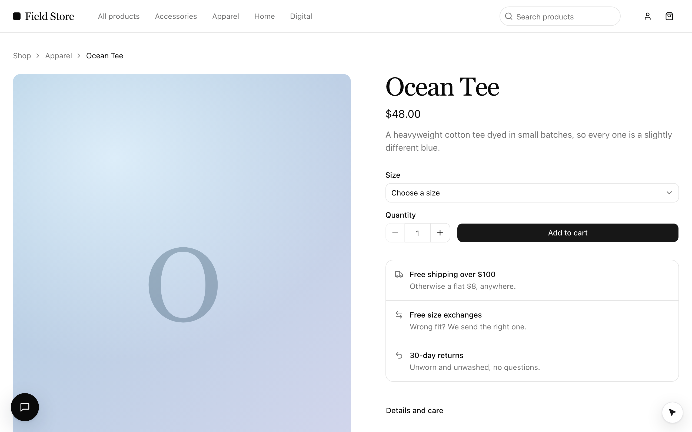

`examples/ecommerce` (**Field Store**) is a minimal, editorial storefront on mock data where every meaningful action is a
tool, on Vite and React Router 7. It shows the ways a tool can be on: everywhere (the catalog), while a component is mounted
(a form on a page), and while the cart drawer is open. The provider line is `<WebAgentsProvider tools={tools}>`, as in every
framework.





## Run it

```bash
pnpm --filter @webmcp-agents/example-ecommerce dev    # http://localhost:5174
pnpm --filter @webmcp-agents/example-ecommerce e2e    # Playwright, desktop + Pixel 7
```

From the devtools (**Alt+Shift+A**), or the console:

```js
await agent.invoke("open_product", { slug: "ocean-tee" });
await agent.invoke("add_to_cart", { variant: "M", qty: 2 });     // the cart drawer opens
await agent.invoke("update_cart_item", { slug: "ocean-tee", qty: 3 });
```

With `ANTHROPIC_API_KEY` in `examples/ecommerce/.env.local` the **Assistant** (bottom left in development) does the same from a
sentence.

## Tools

| Tool | Where | On | Confirm |
|---|---|---|---|
| `search_products` | `useWebTool` in the header's search (types into the field) | everywhere | no |
| `open_product` | catalog, read-only (clicks the product's card when it is listed) | everywhere | no |
| `browse_category` | catalog, read-only (clicks the category's link) | everywhere | no |
| `go_to_page` | catalog (the logo, "All products"; checkout runs unseen) | everywhere | no |
| `get_cart` | catalog, read-only | everywhere | no |
| `open_cart` | catalog, repeatable (the header's cart button) | everywhere | no |
| `add_to_cart` | `useWebTool` + React Hook Form | a product page, in stock | no |
| `update_cart_item` | `useWebTool` in the drawer, repeatable | cart drawer open | no |
| `remove_from_cart` | `useWebTool` in the drawer, destructive | cart drawer open | no (reversible) |
| `close_cart` | `useWebTool` in the drawer | cart drawer open | no |
| `apply_promo` | `useWebTool` + React Hook Form | checkout, no code applied | no |
| `checkout` | `useWebTool` + React Hook Form, `fill` | checkout, cart not empty | **yes**: the cursor types the details and parks on "Place order" |
| `subscribe_newsletter` | `useWebTool` + React Hook Form | home page | **yes** |

Promo code `WELCOME10` takes 10% off; shipping is free from $100.

## The agents

`src/webmcp-agents/agents.ts` defines two. **`shopper`** finds products and fills the cart; it sees every tool except `checkout` and
`apply_promo`. When the person wants to buy it hands the whole purchase to **`checkout`**, a sub-agent
(`delegate_to_checkout`) that sees only the cart and checkout tools, and the order is still confirmed by the person's click
on the page. [Define an agent](/build/define-an-agent) teaches both shapes.

## Patterns worth copying

- **Nothing in the markup is for the cursor.** A tool finds its control by its `title` ("Place order", "Close cart"), or by
  a [locator `target`](/build/define-a-tool#when-the-control-depends-on-the-call) built from the call: the drawer's
  `remove_from_cart` looks for ``{ role: "button", name: `Remove ${label}` }``. The devtools' Tools tab shows what each tool
  resolves to ([Devtools](/build/devtools)).
- **State outside React.** The cart and the drawer are small stores (`src/store/cart.ts`, `src/store/ui.ts`) that components
  read with `useCart()` and `useUi()` and catalog tools import. Catalog tools navigate with the router's own
  `router.navigate` (`src/lib/navigate.ts`, handed over by `main.tsx`), so no call is lost to a page load, and
  `src/webmcp-agents/agents.ts` can import the catalog on the server. [Tools across your app](/build/tools-across-your-app).
- **Tools in the component that owns the control.** `update_cart_item`, `remove_from_cart` and `close_cart` are defined in
  `src/webmcp-agents/tools/` and turned on in `src/webmcp-agents/hooks/use-cart-drawer-tools.ts` with `enabled: cartOpen`; `checkout` is registered in
  `src/webmcp-agents/hooks/use-checkout.ts`, which the checkout form calls, with
  `fill: (values) => form.reset(values)` ([Tools with input](/build/tools-with-input)).
- **Wait for the person.** `checkout` and `subscribe_newsletter` park on their button until a real click
  ([Confirm before it runs](/build/confirm-before-it-runs)).
- **Answer, then navigate.** A tool that leaves its page navigates inside `execute`; `useWebTool` keeps it registered until
  the agent has its answer, so there is no grace period to write ([Tool lifecycle](/concepts/tool-lifecycle)).
- **A non-modal drawer.** The cart drawer is a `role="dialog"` panel with the page behind it `inert`, not `showModal()`: the
  top layer would hide the cursor. `useCartDrawerTools` also listens to agent events and closes it when a tool that is not
  about the cart starts ([`useAgentEvents`](/reference/react/use-agent-events)).
- **Typechecked twice.** `tsconfig.json` covers `src/` (with `vite/client` types), `tsconfig.node.json` covers `api/`,
  `vite.config.ts` and the e2e tests (with `node` types). `src/webmcp-agents/agents.ts` is in both, which is fine: it imports nothing
  environment-specific.
- **Descriptions that chain.** Each tool says what it needs first and what comes next; read `src/webmcp-agents/tools` next to
  [Writing tool descriptions](/concepts/tool-descriptions).
- **`go_to_page` stays the store's own tool** rather than `goTo` from [`@webmcp-agents/tools`](/build/common-tools): checkout
  has no link to click and needs a cart with something in it.
