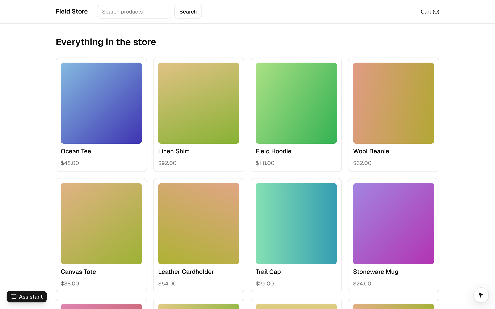
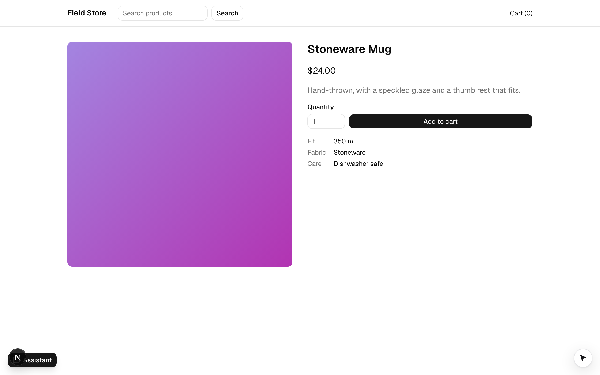

`apps/nextjs` is Field Store again, trimmed to home, product, cart and checkout, on **Next.js 16** (App Router,
Turbopack) with **shadcn/ui** (Tailwind v4). It exists to show three things the Vite examples can't:

- **Server Components render the pages**; only the tools that live in a component and the chat are client components (they need the DOM).
- **The chat is a shadcn block** (`agent-chat` from the `@webmcp-agents` registry), built on `useAgentChat` and
  shadcn/ui's AI patterns: Message Scroller, Tool (Trace), Subagent, Reasoning, Prompt Input, Model Selector.
- **The key never reaches the client**: it lives in a `server-only` module and is tainted with React's
  `experimental_taintUniqueValue`, so a Server Component can't pass it to a client component by accident.





## Run it

```bash
pnpm --filter @webmcp-agents/example-nextjs dev    # http://localhost:5176; builds the packages it consumes first
pnpm --filter @webmcp-agents/example-nextjs e2e    # Playwright, desktop + Pixel 7
```

Put a key in `apps/nextjs/.env.local` (see `.env.example`); never with a `NEXT_PUBLIC_` prefix. In development the
devtools panel is on **Alt+Shift+A**, and `window.agent.invoke("open_product", { slug: "ocean-tee" })` works from the console.

## Where things are

<FileTree>
  - app/
    - layout.tsx (Server Component: fonts, the agent cursor's stylesheet, `<Providers>`)
    - providers.tsx ("use client": `<WebAgentsProvider tools={tools}>`, header, the chat block)
    - page.tsx (home, a Server Component; `?q=` is what `search_products` navigates to)
    - product/[slug]/page.tsx (Server Component + the client `add_to_cart` form)
    - cart/, checkout/ (client views; checkout holds `apply_promo` and the confirm-gated `checkout`)
    - api/chat/route.ts (`createVercelChatRoute({ app, agents, model })`, the example's guarded route)
  - agents.ts (`shopper` with the `checkout` sub-agent: shared by the client and the route)
  - lib/env.server.ts (`server-only` + taint)
  - lib/catalog.ts, lib/cart-store.ts (the cart, no React), lib/cart.tsx (`useCart()`), lib/navigate.ts
  - tools/ (index.ts: the catalog, plain modules; the forms are client components on shadcn's `Form` and React Hook Form)
  - components/web-agents/ (the installed registry blocks: agent-chat, agent-tool, agent-subagent, agent-reasoning, agent-model-selector)
  - components/ui/ (shadcn primitives)
</FileTree>

## Tools and agents

| Tool | Where | On |
|---|---|---|
| `search_products` | `useWebTool` in the header, shadcn `Form` | everywhere |
| `open_product`, `go_to_page`, `get_cart` | catalog (`tools/index.ts`, no React) | everywhere |
| `add_to_cart` | `useWebTool`, shadcn `Form` with a `Select` for the size and `fill` | a product page |
| `apply_promo` | `useWebTool`, shadcn `Form` | checkout, no code applied |
| `checkout` | `useWebTool`, shadcn `Form` with a `Select` for the country and `fill`, `requireConfirmation` | checkout; the cursor types the details, `fill` sets the country, and it parks on **Place order** until the person clicks |

`shopper` sees everything but `apply_promo` and `checkout`; it hands a purchase to the `checkout` sub-agent
(`delegate_to_checkout`), which runs with those two tools plus `get_cart` and `go_to_page` (listed by reference for the
catalog tools, by id for the two a component owns). In the chat the delegate call shows as a Subagent trace with the
nested tool lines inside ([Define an agent](/build/define-an-agent)).

The chat route is the example's guarded one, from the private `@webmcp-agents/vercel-api` package; in your own app it is
`createChatHandler` ([Add the chat](/build/add-the-chat)).

## Try it

<Steps>
  <Step title="Ask for a mug">
    Open the Assistant (bottom left in development) and send "Add a ceramic mug to my cart". `open_product` and `add_to_cart` show
    as Trace lines while the cursor works the page.
  </Step>
  <Step title="Check out through the sub-agent">
    "Check out with promo WELCOME10 to ada@example.com, 1 Main St". The shopper delegates; the Subagent trace nests
    `get_cart`, `go_to_page`, `apply_promo` and `checkout`, which parks: "Confirm on the page". Click **Place order**.
  </Step>
  <Step title="See that the key stays put">
    View source: no key. The route answers `GET /api/chat` with `{ enabled, model, provider, agents }` and nothing
    else. Pass `env.anthropicKey` from `lib/env.server.ts` as a prop to a client component: React throws, because the
    key is tainted.
  </Step>
</Steps>

## Patterns worth copying

- **`next.config.ts` turns the taint APIs on** (`experimental: { taint: true }`): React's taint APIs exist only behind that flag.
- **`server-only` + taint** for the one secret (`lib/env.server.ts`); the route handler reads `process.env` itself
  ([Add the chat](/build/add-the-chat#the-key)).
- **Consume the built packages** (`dist`), not the `@webmcp-agents/source` condition: Turbopack has no custom export
  conditions, and this is the published shape anyway. `predev` builds the dependencies.
- **The cursor stylesheet is a plain import** in `app/layout.tsx` (`import "@webmcp-agents/core/cursor.css"`), the
  same line as in a Vite app: it has no pseudo-class Turbopack's CSS parser would refuse.
- **The same provider line as every other app,** `<WebAgentsProvider tools={tools}>`: the library follows the URL itself,
  so there is no `usePathname` and no router hook ([Tools across your app](/build/tools-across-your-app)).
- **A shadcn `Select` is a custom widget.** The cursor visits it but has nothing to type into, so the forms with one pass
  `fill: (values) => form.reset(values)` ([Tools with input](/build/tools-with-input)). `components/ui/form.tsx` is shadcn's `Form`
  for React Hook Form in the base-nova style.
- **Catalog tools are plain modules with no React** (`defineWebTool` from core, the cart store in `lib/cart-store.ts`):
  `agents.ts` lists them by reference, and the chat route imports `agents.ts` on the server. They navigate with the App
  Router's `router.push`, handed over by `<Providers>` (`lib/navigate.ts`).
- **No "ready" gate.** `<Providers>` renders the provider, the header and the page on the server; in a browser without
  WebMCP the provider loads the polyfill itself and the tools register once it is there. In `next dev` the provider
  installs the devtools too (they give `window.agent` to the e2e tests); `<Providers>` has no code for them.

## Learn more

[Install in a Next.js app](/installation/nextjs) is the same setup for your own project. [Use your shadcn
components](/more/shadcn-chat-blocks) covers the chat blocks, [Define an agent](/build/define-an-agent) the `shopper` and its
`checkout` sub-agent, and [`useAgentChat`](/reference/chat/use-agent-chat) the hook underneath.
