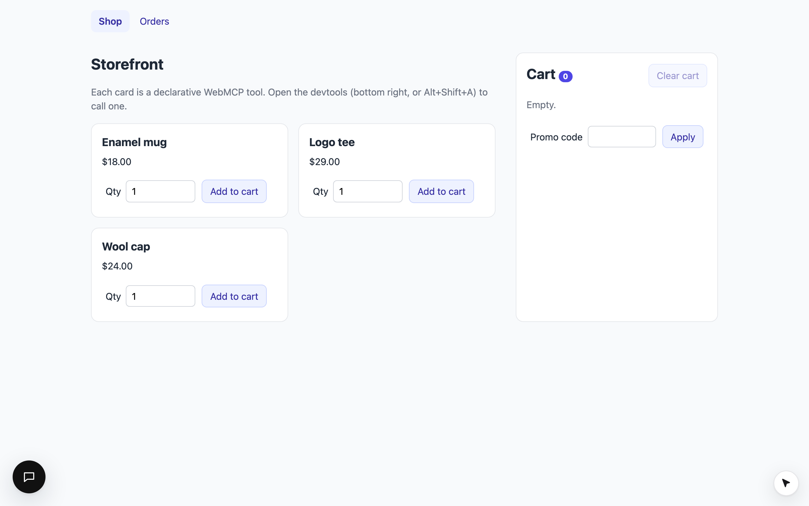

`apps/playground` is the smallest complete example: a storefront where every action is a tool, with one of each kind.



```bash
pnpm install
pnpm --filter playground dev    # http://localhost:5173
```

## The layers

<FileTree>

- apps/playground/src/
  - tools/ (pure: no cursor code anywhere)
    - AddToCartForm.tsx (declarative, add_to_cart_SKU, autosubmit)
    - ApplyPromoForm.tsx (declarative, apply_promo; only "123" is valid)
    - CheckoutForm.tsx (declarative, place_order: no autosubmit, so the browser pauses)
    - ClearCartButton.tsx (useWebTool with requireConfirmation)
    - catalog.ts (WebTools: get_cart, list_orders, remove_promo)
  - App.tsx (WebAgentsProvider: installs the cursor, chat, devtools)
  - store.tsx (the cart)
  - main.tsx (polyfill in dev, then render)

</FileTree>

| Tool | Kind | On | Confirm |
|---|---|---|---|
| `add_to_cart_<sku>` | declarative, one per product | always | no (`toolautosubmit`) |
| `apply_promo` | declarative | until a code is applied | no |
| `remove_promo` | `WebTool`, component-scoped | while an applied code is shown | no |
| `place_order` | declarative, no fields | while the cart has items | **yes** |
| `clear_cart` | `WebTool` via `useWebTool` | while the cart has items | **yes** |
| `get_cart` | `WebTool`, global | always | no |
| `list_orders` | `WebTool`, route-scoped | on `/orders` | no |

## Try it

Open the devtools (bottom right, or **Alt+Shift+A**):

<Steps>
  <Step title="Add to cart">
    Run `add_to_cart_mug-01` with qty 3. The cursor glides to the qty field, types `3`, clicks **Add to cart**, and the
    cart updates on the click.
  </Step>
  <Step title="Apply a promo">
    Run `apply_promo` with `{"code":"123"}`. The totals show 10% off, and the form (and its tool) goes away; **Remove**
    brings it back. Any other code shows an error under the field, and the agent gets the same message.
  </Step>
  <Step title="Place the order">
    Run `place_order`. The cursor parks on **Place order** with "Click … to confirm". Click it yourself to finish.
  </Step>
  <Step title="Take over">
    Run `add_to_cart_tee-02` and move your mouse while the cursor travels. It vanishes; the tool still completes.
  </Step>
</Steps>

With `ANTHROPIC_API_KEY` in `apps/playground/.env.local`, the **Assistant** (bottom left in development) does all of
this from a sentence: "add three mugs and check out with code 123".
