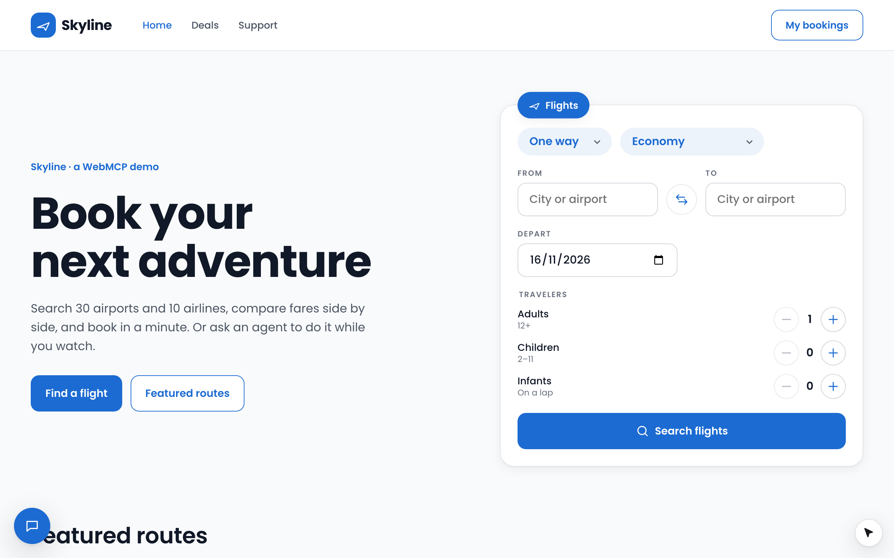
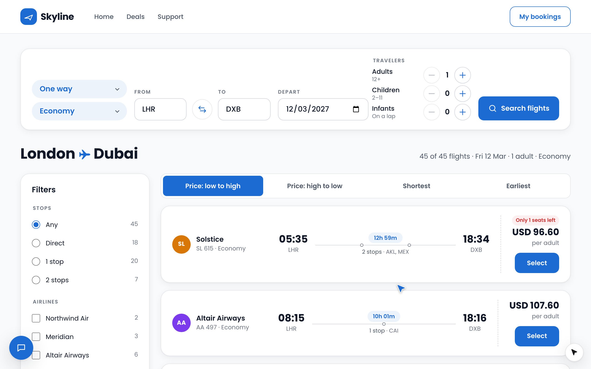

`apps/flights` (**Skyline**) books flights on deterministic mock data, on Vite and React Router 7: the same search always
returns the same flights and ids. Search, filter and sort the results, pick a flight, fill in the travelers and book. Every
step is a tool, and booking waits for the person.





<video autoPlay loop muted playsInline data-no-zoom width="960">
  <source src="../media/examples/skyline-booking.webm" type="video/webm" />
  <source src="../media/examples/skyline-booking.mp4" type="video/mp4" />
</video>

*Search, results, select a flight: each a tool call under the cursor.*

## Run it

```bash
pnpm --filter @webmcp-agents/example-flights dev     # http://localhost:5175
pnpm --filter @webmcp-agents/example-flights e2e     # Playwright, desktop + Pixel 7
```

From the devtools (**Alt+Shift+A**), or the console:

```js
await agent.invoke("search_flights", { from: "RUH", to: "DXB", date: "2027-03-12" });
await agent.invoke("filter_results", { stops: "0" });
await agent.invoke("list_results", { limit: 3 });                 // ids for select_flight
await agent.invoke("select_flight", { flightId: "F-…" });
```

With `ANTHROPIC_API_KEY` in `apps/flights/.env.local` the **Assistant** (bottom left in development) runs the `concierge`
agent, which knows the booking flow in a few plain lines.

## Tools

| Tool | Where | On | Confirm |
|---|---|---|---|
| `search_flights` | `useWebTool` + React Hook Form (types into every field) | home and results pages | no |
| `get_booking` | catalog, read-only | everywhere | no |
| `get_location` | catalog, read-only: the common `getLocation` with a reverse-geocoding `lookup`, plus the nearest airports | everywhere | no |
| `get_time` | catalog: the common `getTime()` with Skyline's description (dates as `YYYY-MM-DD`) | everywhere | no |
| `filter_results` | catalog, `match` (ticks the stops radio; on a phone, the Filters button) | a results page | no |
| `sort_results` | catalog, `match` (that sort's button) | a results page | no |
| `list_results` | catalog, `match`, read-only | a results page | no |
| `select_flight` | catalog, `match` (that flight's own Select button) | a results page | no |
| `fill_traveler_details` | `useWebTool` + **TanStack Form** | the booking page | no |
| `book_flight` | `useWebTool` + React Hook Form, `fill` | the booking page | **yes**: the cursor ticks the fare rules and parks on "Book flight" |

## Patterns worth copying

- **The search is the URL** (`/flights/lhr/dxb/oneway/economy/1/0/0/2026-11-20`). A loader validates it, and a bad URL
  renders a readable error instead of a blank page.
- **Results tools say where they are on.** `filter_results` and friends carry `match: RESULTS_PATTERN`: the library follows
  the URL, so they turn on and off with back and forward and nothing is wired to React Router.
  [Where a tool is on](/build/where-a-tool-is-on).
- **Store first, then navigate.** A `match` tool turns on as soon as the URL changes, before the results page has rendered,
  so `search_flights` stores the search **before** it navigates (the tools read it).
  [Tool lifecycle](/concepts/tool-lifecycle#tools-that-come-and-go-with-the-url).
- **Context tools.** `get_time` and `get_location` answer what a model cannot know ("next Friday", "from here"), so the
  agent does not invent a date or an airport. `get_time` is the common tool; `get_location` is the common one with a
  `lookup` and Skyline's airports on top ([Common tools](/build/common-tools)).
- **Any form library.** The search and booking forms are React Hook Form; the traveler details are TanStack Form, and the
  cursor types into both. The stops filter is a radio group named `stops`, so the cursor ticks the radio it sets as a
  field ([Tools with input](/build/tools-with-input)).
- **One control per call.** `select_flight` targets `{ role: "button", name: "Select Meridian MR 210" }`: that flight's own
  button, from the call's input ([Define a tool](/build/define-a-tool#when-the-control-depends-on-the-call)).
- **Real fields.** Travelers are inline counters rather than a popover, so the agent fills visible fields.
- **Wait for the person.** `book_flight` parks on "Book flight" until a real click
  ([Confirm before it runs](/build/confirm-before-it-runs)).
- **The agent** (`concierge`) lives in `src/agents.ts` and is shared by the chat, the Vite dev plugin and `api/chat.ts`
  ([Define an agent](/build/define-an-agent)).
