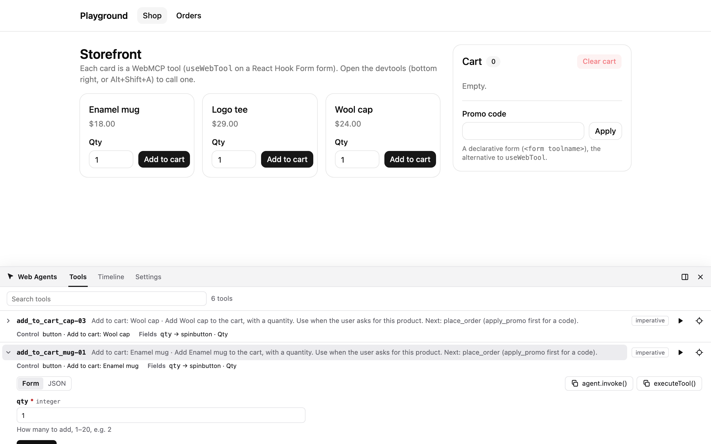
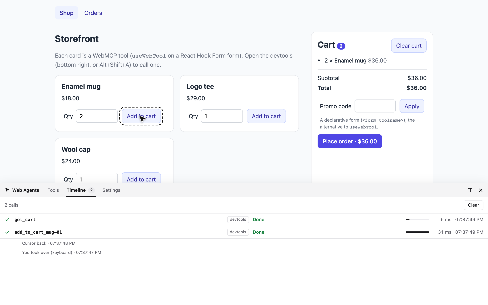
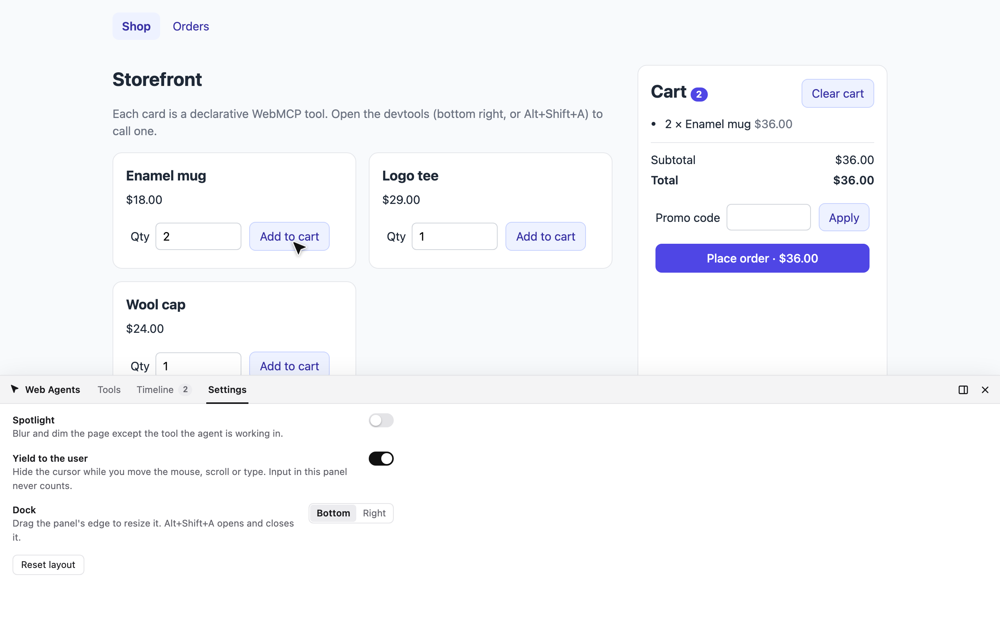

`@webmcp-agents/devtools` is a panel for WebMCP pages. You play the agent from it, and it records what any agent does.

```bash
pnpm add -D @webmcp-agents/devtools
```

## Add it (development only)

<Tabs>
  <Tab title="React">

    ```tsx
    import { lazy, Suspense } from "react";

    // The condition guards the import() itself, so production bundles leave the devtools out.
    const Devtools = import.meta.env.DEV
      ? lazy(() => import("@webmcp-agents/devtools/react").then((m) => ({ default: m.WebAgentsDevtools })))
      : () => null;

    <WebAgentsProvider tools={catalog} visuals={{ spotlight: true }}>
      <App />
      <Suspense>
        <Devtools initialSettings={{ spotlight: true }} />
      </Suspense>
    </WebAgentsProvider>;
    ```

    Inside the provider, its Settings switches drive the provider's cursor.

  </Tab>
  <Tab title="TanStack Devtools">

    ```tsx
    import { TanStackDevtools } from "@tanstack/react-devtools";
    import { webAgentsDevtoolsPlugin } from "@webmcp-agents/devtools/react";

    <TanStackDevtools plugins={[webAgentsDevtoolsPlugin()]} />;
    ```

    A "Web Agents" tab with the same panel. Render it inside your `<WebAgentsProvider>`.

  </Tab>
  <Tab title="Vanilla">

    ```ts
    import { installAgentVisuals } from "@webmcp-agents/core";
    import { installWebAgentsDevtools } from "@webmcp-agents/devtools";

    const visuals = installAgentVisuals({ spotlight: true });
    if (import.meta.env.DEV) installWebAgentsDevtools({ visuals, initialSettings: { spotlight: true } });
    ```

  </Tab>
</Tabs>

Open it with the button in the bottom-right corner or **Alt+Shift+A**.

## What's in it







- **Tools.** Every registered tool, refreshed as tools come and go, with badges (form or code, read-only,
  destructive, needs confirmation, off screen). **Locate** scrolls to the tool's element and flashes it.
- **Runner.** A form generated from the tool's JSON Schema (strings, enums, dates, numbers, booleans, nested objects
  and arrays), with a raw JSON fallback. **Run** with `⌘/Ctrl+Enter`, and copy the call as `agent.run()` or
  `executeTool()` code.
- **Timeline.** Newest first: the arguments, the fields the cursor typed, the "waiting for you" state, the result or
  error with its code, a duration bar, markers where you took over from the cursor, and **Re-run**.
- **Settings.** Spotlight and yield-to-user switches wired to the cursor, plus dock position and size. Saved in
  `localStorage`.

The panel lives in a shadow root (no CSS leaks either way) and its host carries `data-web-agents-ui`, so using it
never makes the cursor yield.

## From the console

```js
await agent.list();
await agent.run("add_to_cart_mug-01", { qty: 3 });
```

Calls made that way appear on the timeline too. End-to-end tests can drive tools the same way; the example apps'
Playwright tests do.

## Limits

- Agent events carry no call id, so two concurrent calls of the same tool can mix their fills on the timeline.
- An agent's arguments aren't visible, only the fields the cursor typed.
- **Cancel** works for runs started from the panel everywhere, but for another agent's call only with the polyfill:
  native Chrome lets only the caller cancel.
- The hotkey is real keyboard input, so pressing it makes the cursor yield for a moment.
