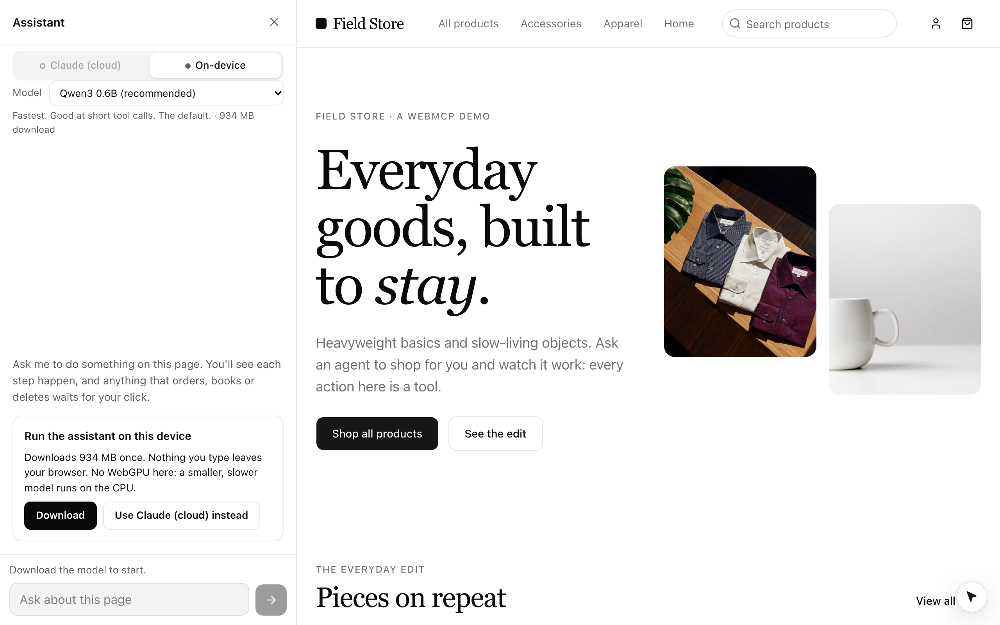

`@webmcp-agents/local-agent` is an `AgentAdapter` for [`<AgentChat>`](/build/add-the-chat) whose model runs in the visitor's
browser. There is no server and no API key, and nothing the person types leaves the device. It sits next to the cloud
assistant: the chat shows a switcher, *Claude (cloud)* and *On-device*.

## Add it to the chat

You already have the chat from [Add the chat](/build/add-the-chat). Install the adapter, create both adapters once per page
(outside any component), and hand them to `<AgentChat>`.

```package-install
npm install @webmcp-agents/local-agent
```

The model runs in a module Web Worker that the package creates with `new Worker(new URL(…, import.meta.url))`, so the
bundler must see it unbundled. How you say so depends on the framework.

<View title="Vite">

```tsx src/main.tsx
import { createCloudAdapter } from "@webmcp-agents/chat"; // [!code highlight]
import { createLocalAdapter } from "@webmcp-agents/local-agent"; // [!code highlight]

const adapters = [createCloudAdapter(), createLocalAdapter()]; // [!code highlight]

// …
<AgentChat agent={shopper} adapters={adapters} /> // [!code highlight]
```

Keep the worker out of Vite's dependency pre-bundling, and bundle it as an ES module:

```ts vite.config.ts
export default defineConfig({
  // …
  optimizeDeps: { exclude: ["@webmcp-agents/local-agent", "@huggingface/transformers"] }, // [!code highlight]
  worker: { format: "es" }, // [!code highlight]
});
```

This is the setup the playground, Field Store and Skyline apps run.

</View>

<View title="Next.js">

```tsx app/providers.tsx
"use client";

import { createCloudAdapter } from "@webmcp-agents/chat"; // [!code highlight]
import { createLocalAdapter } from "@webmcp-agents/local-agent"; // [!code highlight]

const adapters = [createCloudAdapter(), createLocalAdapter()]; // [!code highlight]

// …
<AgentChat agent={shopper} adapters={adapters} /> // [!code highlight]
```

The adapters live in a client component, because the model needs the browser. Next.js's bundlers follow the
`new Worker(new URL(…, import.meta.url))` form the package ships, so try it without any bundler config. No example app
runs the on-device adapter on Next.js yet: if the model never loads, hand the adapter a worker of your own (below).

</View>

<View title="TanStack Start">

```tsx src/components/providers.tsx
import { createCloudAdapter } from "@webmcp-agents/chat"; // [!code highlight]
import { createLocalAdapter } from "@webmcp-agents/local-agent"; // [!code highlight]

const adapters = [createCloudAdapter(), createLocalAdapter()]; // [!code highlight]

// …
<AgentChat agent={shopper} adapters={adapters} /> // [!code highlight]
```

TanStack Start runs on Vite, so it needs the same two settings:

```ts vite.config.ts
export default defineConfig({
  // …
  optimizeDeps: { exclude: ["@webmcp-agents/local-agent", "@huggingface/transformers"] }, // [!code highlight]
  worker: { format: "es" }, // [!code highlight]
});
```

No example app runs the on-device adapter on TanStack Start yet: the setting is Vite's, not something this project
has exercised there.

</View>

<View title="Astro">

```tsx src/components/providers.tsx
import { createCloudAdapter } from "@webmcp-agents/chat"; // [!code highlight]
import { createLocalAdapter } from "@webmcp-agents/local-agent"; // [!code highlight]

const adapters = [createCloudAdapter(), createLocalAdapter()]; // [!code highlight]

// …
<AgentChat agent={shopper} adapters={adapters} /> // [!code highlight]
```

Astro runs on Vite, and hands it options under `vite`:

```js astro.config.mjs
export default defineConfig({
  // …
  vite: {
    optimizeDeps: { exclude: ["@webmcp-agents/local-agent", "@huggingface/transformers"] }, // [!code highlight]
    worker: { format: "es" }, // [!code highlight]
  },
});
```

No example app runs the on-device adapter on Astro yet: the setting is Vite's, not something this project has
exercised there.

</View>

If your bundler cannot follow the worker URL, pass the worker yourself. With Vite's `?worker` import:

```ts
import LocalWorker from "@webmcp-agents/local-agent/worker?worker";

createLocalAdapter({ worker: () => new LocalWorker() });
```

## Which model runs

The first available provider wins:

| Provider | When | Download |
|---|---|---|
| Chrome's built-in model (Prompt API) | desktop Chrome with the built-in model | none per site; Chrome manages it |
| transformers.js + WebGPU | WebGPU is available | Qwen3 0.6B, about 585 MB |
| transformers.js + WASM | no WebGPU | Qwen3 0.6B, about 934 MB, slower |

Other models are opt-in through `model`, or offered side by side through `models`: the chat then shows a picker with each
model's brief, size and whether it is already on the device, and remembers the choice.

```ts
createLocalAdapter({
  models: [
    "onnx-community/Qwen3-0.6B-ONNX", // the default
    "onnx-community/Qwen3-1.7B-ONNX", // needs 8 GB and WebGPU
    "LiquidAI/LFM2.5-1.2B-Instruct-ONNX",
  ],
});
```

`LiquidAI/LFM2.5-1.2B-Instruct-ONNX` (about 764 MB) is trained for tool calling and handles multi-step tasks Qwen3 0.6B
cannot, but needs a strong GPU and plenty of free memory. Qwen3 1.7B (1.4 GB) reasons better and needs 8 GB and WebGPU.

## What the visitor sees



- **Consent first.** Nothing downloads until the person clicks **Download** in the chat, which shows the size. Progress
  is determinate, and **Cancel** stops it.
- **Downloaded once.** Files are kept in the browser's Cache API and the page asks for persistent storage, so a returning
  visitor loads from disk. The chat asks transformers.js whether the files are there, so it never shows a Download
  button for a model that is, and a load from disk reads "Loading the model from this device…", not "Downloading".
- **No jank.** The model and ONNX Runtime load only inside the worker, so generating never stutters the page or the
  cursor. Your main bundle does not include them.

## Site instructions

Small models cannot infer a site's flow from tool names. Give the page an agent
([Define an agent](/build/define-an-agent)): the on-device model reads its instructions and tool subset in the browser,
the same definition the cloud reads on the server.

```ts
const concierge = defineWebAgent({
  id: "concierge",
  instructions: `Skyline books flights in this order: search_flights,
then list_results, then select_flight with an id from the results,
then fill_traveler_details, then book_flight (the user confirms on the page).`,
});
```

They go into the system prompt under "About this site". Keep them short: every token counts against a small context
window. Without an agent, `createLocalAdapter({ instructions })` still works as a fallback.

## Guard rails for small models

The loop is built for models of a billion parameters or so:

- at most 8 tools per step, ranked against the request, with compact schemas;
- tool calls parsed leniently, checked against the schema, and fed back once if wrong;
- replies checked before they are shown: a reply that claims a failed call worked, or tells the person to click a button
  a tool could press, is corrected;
- at most 6 steps and 60 s per step, and a stop when the same call repeats.

## Not freezing the machine

A model on WebGPU holds hundreds of megabytes of GPU memory, shared with the whole system on Apple silicon. So the provider
loads **one model per browser** (a Web Lock shared by every tab), frees it when the page is hidden, refuses models over
650 MB on devices reporting less than 8 GB of memory, and caps the prompt length.

## Limits

Models this size handle one explicit action well ("add 2 mugs to the cart") and multi-step plans poorly. Offer the cloud
assistant next to it for anything bigger. Full reference: [`createLocalAdapter`](/reference/local-agent/create-local-adapter).
