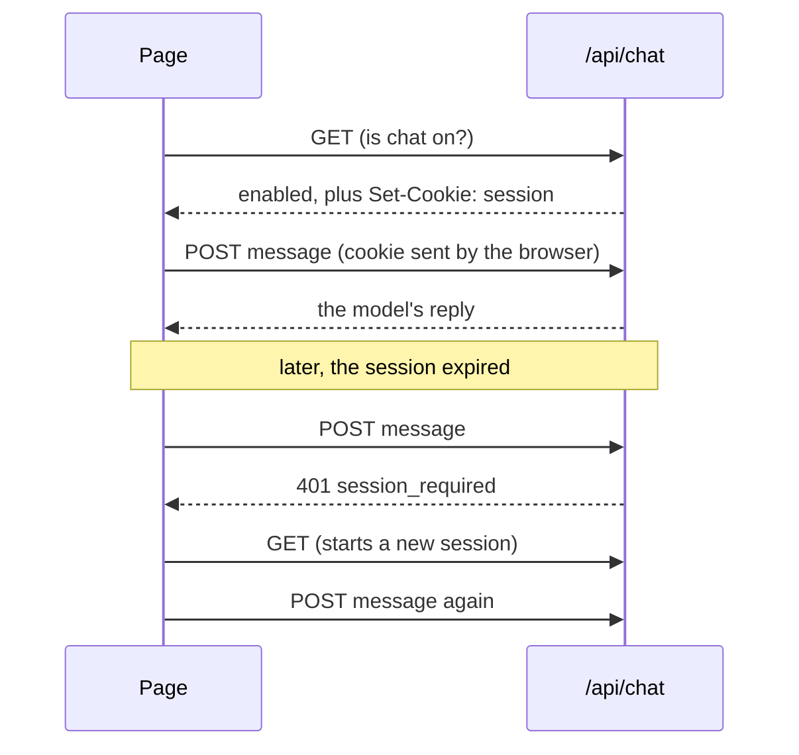

A chat session is a random id the server gives the page in a cookie, and checks on every message. Turn it on with one
option on your route; the page needs no change.

```ts
const handler = createChatHandler({
  agents,
  session: true, // or { ttl, maxAge, cookie, verify, turnstile }
});
```

## How it works



- **The chat already makes that GET.** It asks whether chat is configured before it shows itself, so the cookie is
  there before the first message. A message sent before that (or after the session expired) gets `401
  session_required`, and the chat starts a session and sends it again, once.
- **The cookie can't be read or sent elsewhere.** It is `HttpOnly` (no script on the page reads it), `SameSite=Strict`
  (no other site's page sends it), scoped to the route's path, and `Secure` over https.
- **The server stores nothing.** The cookie is `v1.<id>.<expires>.<born>.<signature>`: 128 random bits, signed with
  HMAC-SHA256 under your secret. Any instance with the same secret checks it.
- **A refusal costs nothing.** The cookie is checked before the request body is read, so a flood without one never
  reaches the model, the parser or your budget.

## The secret

Sessions are signed with `WEB_AGENTS_SESSION_SECRET`, at least 32 characters. Generate one and set it on the server,
never with a public prefix (`VITE_`, `NEXT_PUBLIC_`, `PUBLIC_`):

```bash
openssl rand -base64 32
```

Without it, each server process makes up its own. That is fine for one dev server, and wrong for a deployment: a
serverless host runs many instances, a cookie from one fails on the next, and the chat keeps starting new sessions.
`@webmcp-agents/vercel-api` refuses to turn chat on in a Vercel production or preview deployment without it. To rotate
it, set a new value and redeploy: open sessions end, and every page starts a new one on its next message.

## How long a session lives

| Option | Default | What it does |
|---|---|---|
| `ttl` | 1800 s | Without a request for this long, the session ends. Each message past half of it renews the cookie (same id). |
| `maxAge` | 86400 s | After this, a session is not renewed: the page starts a new one, with a new id. |
| `cookie` | `web_agents_session` | The cookie's name. |

## Limit each session

Every request now has a session id, handed to `beforeModel`. Count requests per session there, after the request is
validated, so malformed ones never use the allowance:

```ts
const handler = createChatHandler({
  session: true,
  beforeModel: async (req, { session }) => {
    const ok = await limiter.limit(`session:${session}`); // your store
    return ok ? undefined : new Response("Too many requests", { status: 429 });
  },
});
```

`@webmcp-agents/vercel-api` does this for you: 150 requests per session per day (`RATE_LIMIT_PER_SESSION`). See
[Limits and budgets](/security/limits).

## What it stops, and what it doesn't

- **Stops:** a bare `curl -X POST`, scripts that don't keep cookies, other sites' pages, unbounded use of one session.
- **Doesn't stop:** a script that does `GET` first and keeps the cookie. Starting a session is free until something
  makes it cost: that is [Turnstile](/security/turnstile), or your own check in `verify`.

## Edge cases

- **Several tabs** share one cookie, so one session and one allowance.
- **Cookies blocked** (some privacy modes): the chat can't keep a session and says "Couldn't start a chat session.
  Reload the page and try again."
- **An endpoint on another origin** (`api: "https://api.example.com/chat"`): `SameSite=Strict` keeps the cookie off
  cross-site requests. Serve the route from the page's own origin, or under the same site.
- **Plain http on a LAN address**: the cookie is set without `Secure`, so it works in development; browsers treat
  `localhost` as secure anyway.
- **`agent.invoke` and other adapters** share the browser's cookie, so they work once the page has a session.

## Try it

With the route running, a POST without the cookie is refused:

```bash
curl -s -X POST http://localhost:5173/api/chat -H 'content-type: application/json' -d '{}'
# {"error":"session_required",…}
```

Then open the page, send a message, and look for `web_agents_session` under the site's cookies in DevTools
(Application, Cookies): marked HttpOnly, invisible to `document.cookie`.
