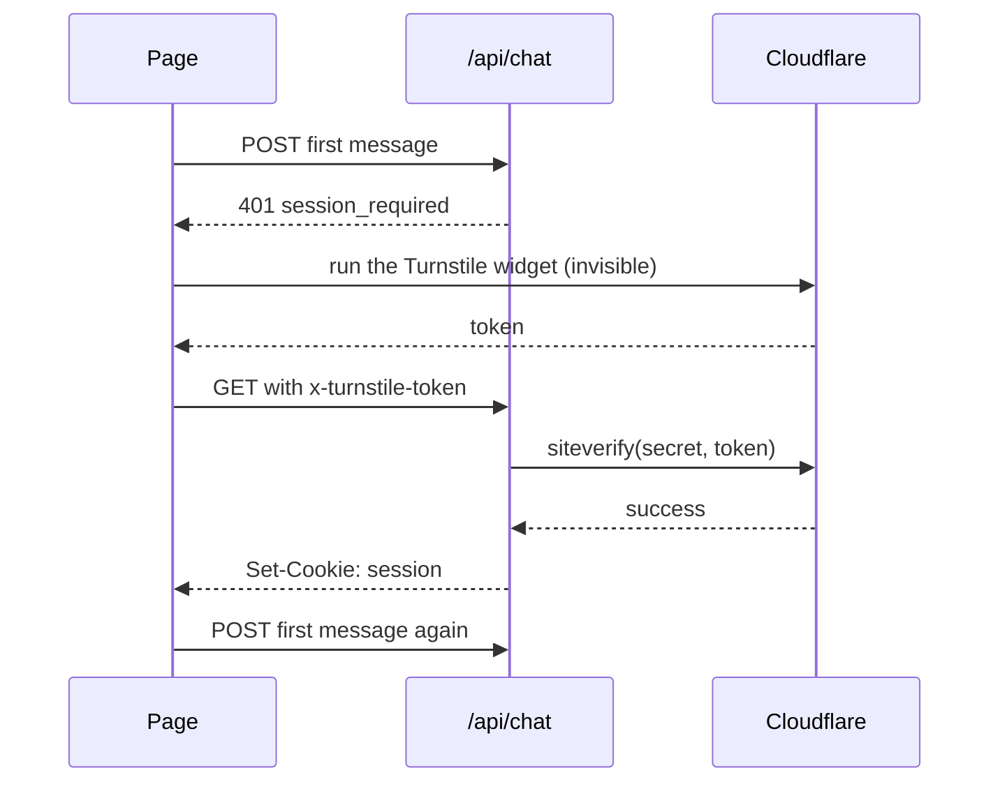

Without a check, a script can `GET` your route, keep the cookie and chat. Turnstile makes each new session cost a
solved Cloudflare challenge: invisible for nearly everyone, a click when Cloudflare is unsure, and a wall for a script
in a loop. It needs [sessions](/security/sessions) on.

## How it works



- **Nothing loads until it is needed.** A visitor who never chats never loads Cloudflare's script. The first message of
  a session loads it, runs the widget and removes it as soon as it answers.
- **One token, one session.** Tokens are single-use. Later messages ride on the session cookie; the next challenge
  comes with the next session (after 30 minutes idle, or a day).
- **It fails closed.** No token, a rejected token, Cloudflare unreachable or slower than 5 s: no session.

## Set it up

1. In the Cloudflare dashboard, open **Turnstile**, then **Add widget**: your domains (add `localhost` for development)
   and the mode **Managed** or **Invisible**. You get a site key and a secret key.
2. Put the **secret** on the server as `TURNSTILE_SECRET_KEY`, never with a public prefix.
3. Put the **site key** where the page reads it: it is public, so it does get the prefix (`VITE_`, `NEXT_PUBLIC_`,
   `PUBLIC_`).

Set both or neither: a secret without the site key on the page means no session can ever start.

## The server

One option on the route. `true` reads the secret from `TURNSTILE_SECRET_KEY`, and creating the handler throws without
it:

```ts
const handler = createChatHandler({
  agents,
  session: { turnstile: true },
});
```

[The complete route](/security#a-complete-example) turns it on only when the secret is set, so the same file works
before you set Turnstile up. `@webmcp-agents/vercel-api` and the Vite dev plugin do that by themselves.

Pass options instead of `true` to tighten it: `hostname` (accept tokens solved on your domains only), `action` (the
page sends `"web_agents_chat"`), `timeout`. See [Turnstile options](/reference/chat/create-chat-handler#turnstile).

## The page

Give the chat a cloud adapter that solves the challenge when the server asks for a session. Create it once, at module
scope, and pass it to the chat.

<View title="Vite">

```tsx src/main.tsx
import { createCloudAdapter, turnstileHeaders } from "@webmcp-agents/chat"; // [!code highlight]

const cloud = createCloudAdapter({ // [!code highlight]
  sessionHeaders: turnstileHeaders({ // [!code highlight]
    siteKey: import.meta.env.VITE_TURNSTILE_SITE_KEY, // [!code highlight]
  }), // [!code highlight]
}); // [!code highlight]

// Where the chat is:
<AgentChat agent={shopper} adapters={[cloud]} /> // [!code highlight]
```

</View>

<View title="Next.js">

```tsx app/providers.tsx
import { createCloudAdapter, turnstileHeaders } from "@webmcp-agents/chat"; // [!code highlight]

const cloud = createCloudAdapter({ // [!code highlight]
  sessionHeaders: turnstileHeaders({ // [!code highlight]
    siteKey: process.env.NEXT_PUBLIC_TURNSTILE_SITE_KEY!, // [!code highlight]
  }), // [!code highlight]
}); // [!code highlight]

// Where the chat is:
<AgentChat agent={shopper} adapters={[cloud]} /> // [!code highlight]
```

</View>

<View title="TanStack Start">

```tsx src/routes/__root.tsx
import { createCloudAdapter, turnstileHeaders } from "@webmcp-agents/chat"; // [!code highlight]

const cloud = createCloudAdapter({ // [!code highlight]
  sessionHeaders: turnstileHeaders({ // [!code highlight]
    siteKey: import.meta.env.VITE_TURNSTILE_SITE_KEY, // [!code highlight]
  }), // [!code highlight]
}); // [!code highlight]

// Where the chat is:
<AgentChat agent={shopper} adapters={[cloud]} /> // [!code highlight]
```

</View>

<View title="Astro">

```tsx src/components/app.tsx
import { createCloudAdapter, turnstileHeaders } from "@webmcp-agents/chat"; // [!code highlight]

const cloud = createCloudAdapter({ // [!code highlight]
  sessionHeaders: turnstileHeaders({ // [!code highlight]
    siteKey: import.meta.env.PUBLIC_TURNSTILE_SITE_KEY, // [!code highlight]
  }), // [!code highlight]
}); // [!code highlight]

// Where the chat is:
<AgentChat agent={shopper} adapters={[cloud]} /> // [!code highlight]
```

</View>

If the page offers an on-device model too, keep it in the list: `adapters={[cloud, local]}`. Only the cloud adapter
talks to your route.

## Test it

Cloudflare's test keys work on any domain, `localhost` included, with no account:

| Site key | Secret | Result |
|---|---|---|
| `1x00000000000000000000AA` | `1x0000000000000000000000000000000AA` | Always passes (invisible) |
| `2x00000000000000000000AB` | `2x0000000000000000000000000000000AA` | Always fails |
| `3x00000000000000000000FF` | `1x0000000000000000000000000000000AA` | Forces the interactive challenge |

Send a message with the first pair and look for the `web_agents_session` cookie; with the always-fail secret, the chat
says "Couldn't start a chat session".

## Edge cases

- **A Content-Security-Policy** must allow `https://challenges.cloudflare.com` in `script-src` and `frame-src`.
- **The script blocked** (an extension, a network that blocks Cloudflare): no session, and the chat says so. Nothing
  else on the page is affected.
- **A click is needed**: the widget shows at the bottom of the page and waits up to a minute. It is marked as library
  UI, so clicking it never makes the agent cursor yield.
- **Privacy**: Cloudflare sees the visitor's request to its challenge, as with any Turnstile page. Say so in your
  privacy policy if you list processors.
- **Another bot check** (Vercel BotID, your own): use `session.verify` on the server and `sessionHeaders` on the
  adapter the same way.
